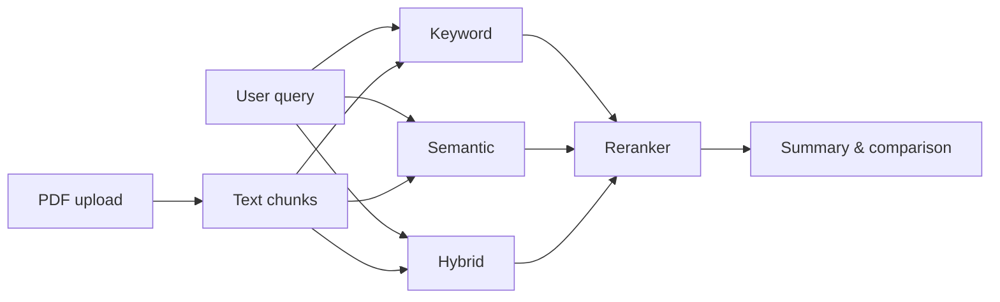

# RTEB Retrieval Dashboard

Compare **Keyword**, **Semantic**, and **Hybrid** search on any PDF—in one Streamlit app. Upload a document, ask a question, and see which retrieval strategy surfaces the best passages, with **cross-encoder reranking** and an **extractive summary** built only from text in your file.

**Repository:** [github.com/jenniferlinet/rteb](https://github.com/jenniferlinet/rteb)

---

## Table of contents

- [What this project does](#what-this-project-does)
- [Who it is for](#who-it-is-for)
- [Quick start](#quick-start)
- [User guide](#user-guide)
- [Understanding the results](#understanding-the-results)
- [How retrieval works](#how-retrieval-works)
- [Configuration](#configuration)
- [Deploy online](#deploy-online)
- [Project structure](#project-structure)
- [Troubleshooting](#troubleshooting)
- [Limitations & privacy](#limitations--privacy)
- [Tech stack](#tech-stack)
- [License](#license)

---

## What this project does

RTEB is an **information retrieval playground** for PDFs:

1. **Ingest** — Extract text from an uploaded PDF and split it into overlapping chunks.
2. **Retrieve** — Run the same query through three strategies (keyword, semantic, hybrid).
3. **Rerank** — Score candidate passages with a cross-encoder so the best chunks rise to the top.
4. **Explain** — Show an extractive summary, the best verbatim passage, per-chunk scores, and a simple comparison of all three methods.

No paid API keys are required. Models run locally (or on Streamlit Cloud with lighter defaults).

---

## Who it is for

- Students and developers learning **TF-IDF vs embeddings vs hybrid** retrieval  
- Anyone building **RAG** who wants to see how retrieval choice affects results before adding a generator LLM  
- Portfolio demos: upload a public PDF, ask questions, compare methods live  

---

## Quick start

### Prerequisites

- **Python 3.9+**
- **pip**
- Internet on first run (downloads Hugging Face models once)

### Install and run

```bash
git clone https://github.com/jenniferlinet/rteb.git
cd rteb

python3 -m venv .venv
source .venv/bin/activate          # Windows: .venv\Scripts\activate

python -m pip install --upgrade pip
python -m pip install -r requirements.txt

streamlit run main.py
```

Open the URL Streamlit prints (usually **http://localhost:8501**).

---

## User guide

### Step 1 — Upload a PDF

Use the **Upload a PDF document** control. The app needs a **text-based PDF** (you can select and copy text in Preview/Acrobat). Scanned pages without a text layer will not work unless you OCR them first.

After upload, check the line under the title:

- **Pages**, **chunks**, and **characters extracted** should be greater than zero.

### Step 2 — Ask a focused question

Type a specific question—not a single vague word. Examples:

- *How do I reset my password?*
- *What are the data retention rules in section 4?*
- *What does "permission denied" mean in the troubleshooting table?*

### Step 3 — Choose settings

| Control | Recommendation |
|--------|----------------|
| **Retrieval method** | Start with **Hybrid**; use **Keyword** for exact error codes or product names. |
| **Top k** | **3** is a good default; increase if you want more passages. |

### Step 4 — Read the output (top to bottom)

1. **Extractive answer summary** — Short answer stitched from the best sentences in the PDF (nothing invented).
2. **Best matching passage** — Full chunk with the highest rerank score for your selected method.
3. **Comparison: Keyword vs Semantic vs Hybrid** — Three columns with average match (1–5), count of strong passages, and a **recommended method** for this query.
4. **Retrieved passages** — Detailed cards with similarity, relevance score, verdict, and analysis.

The **first query** after opening the app loads embedding and reranker models and may take **30 seconds to a few minutes** depending on your machine.

---

## Understanding the results

### Relevance score (1–5)

Scores come from a **cross-encoder** that judges how well each passage matches your question. They are **relative within that query’s results**—use them to compare passages and methods, not as absolute truth.

| Score | Typical meaning |
|------|------------------|
| **5** | Directly addresses the question |
| **4** | Clearly relevant |
| **3** | Related but incomplete |
| **2** | Weak connection |
| **1** | Unlikely to help |

Icons: ✅ (4–5), ⚠️ (3), ❌ (1–2).

Always verify important facts in the **cited passage text**, not only the score.

### Method comparison

| Method | Idea | Try it when |
|--------|------|-------------|
| **Keyword** | TF-IDF + cosine similarity | Wording matches the document; error messages; names |
| **Semantic** | Sentence embeddings + cosine similarity | You paraphrase; synonyms; different phrasing |
| **Hybrid** | 50/50 blend of normalized keyword + semantic scores | General questions (default) |

Each method pulls up to **20** candidates, then the **same cross-encoder** reranks them to top **k**.

---

## How retrieval works

```text
PDF upload
    → extract text & chunk (700 chars, 150 overlap)
    → normalize text (e.g. fi ligatures)

User query
    → Keyword / Semantic / Hybrid scores on all chunks
    → top 20 candidates per method
    → cross-encoder rerank
    → top k passages + extractive summary + 3-way comparison
```



**Models (local defaults)**

| Role | Model |
|------|--------|
| Embeddings | `all-mpnet-base-v2` |
| Reranker | `cross-encoder/ms-marco-MiniLM-L-6-v2` |

On **Streamlit Cloud**, set `RTEB_CLOUD=1` to use `all-MiniLM-L6-v2` for lower memory use.

---

## Configuration

Defaults work without a `.env` file. To override, copy `.env.example` to `.env`:

| Variable | Purpose |
|----------|---------|
| `RTEB_CLOUD` | `1` = smaller embedding model (recommended on free cloud hosting) |
| `EMBEDDING_MODEL` | Hugging Face embedding model ID |
| `RERANKER_MODEL` | Hugging Face cross-encoder model ID |

On **Streamlit Community Cloud**, add secrets (see [DEPLOY.md](DEPLOY.md)):

```toml
RTEB_CLOUD = "1"
```

---

## Deploy online

Host a public demo for your portfolio (LinkedIn, resume):

1. Push this repo to GitHub (never commit private PDFs or `.env`).
2. Follow **[DEPLOY.md](DEPLOY.md)** — [Streamlit Community Cloud](https://share.streamlit.io), repo `jenniferlinet/rteb`, main file `main.py`.
3. Add your `https://*.streamlit.app` link at the top of this README.

**Demo tip:** Use only **non-confidential** sample PDFs on public hosts.

---

## Project structure

```text
rteb/
├── main.py                    # Streamlit app (UI + retrieval pipeline)
├── requirements.txt           # Dependencies (CPU PyTorch)
├── DEPLOY.md                  # Streamlit Cloud steps
├── .env.example               # Optional environment variables
├── .gitignore                 # Ignores uploads, indexes, secrets
└── .streamlit/
    ├── config.toml            # App theme & server settings
    └── secrets.toml.example   # Example cloud secrets
```

---

## Troubleshooting

| Problem | What to try |
|---------|-------------|
| **Zero chunks after upload** | PDF may be image-only; use a text-based PDF or OCR first. |
| **Weak or irrelevant passages** | Ask a more specific question; try **Hybrid** or **Keyword**; use words from the document. |
| **Slow first query** | Normal—models download and load once; later queries are faster. |
| **App crashes on Streamlit Cloud** | Set secret `RTEB_CLOUD = "1"`; redeploy; avoid very large PDFs on free tier. |
| **Scores feel “wrong”** | Treat scores as comparative; read the verbatim passage and summary. |

---

## Limitations & privacy

- **Extractive only** — The app quotes the PDF; it does not generate new facts like ChatGPT.
- **No OCR** — Scanned documents need preprocessing.
- **Local/cloud storage** — Uploaded files are written to the server’s disk for processing; do not upload sensitive data to public deployments.
- **`.gitignore`** excludes `uploaded_pdf.pdf`, `dbs/`, and `.env` — keep confidential files out of Git.

---

## Tech stack

- [Streamlit](https://streamlit.io) — UI  
- [scikit-learn](https://scikit-learn.org) — TF-IDF  
- [LangChain](https://python.langchain.com) — PDF loading, splitting, Hugging Face embeddings  
- [Sentence Transformers](https://www.sbert.net) — Cross-encoder reranking  
- [PyTorch](https://pytorch.org) (CPU) — Model runtime  
- [FAISS](https://github.com/facebookresearch/faiss) — Vector index utilities (optional index on disk)

---

## License

MIT License — see [LICENSE](LICENSE) if present in the repository.

---

## Author

**Jennifer Linet** — [GitHub @jenniferlinet](https://github.com/jenniferlinet)

Questions or improvements? Open an issue or pull request on the repository.
